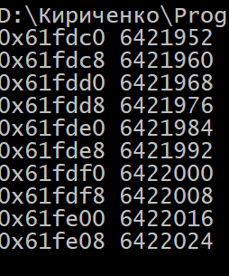
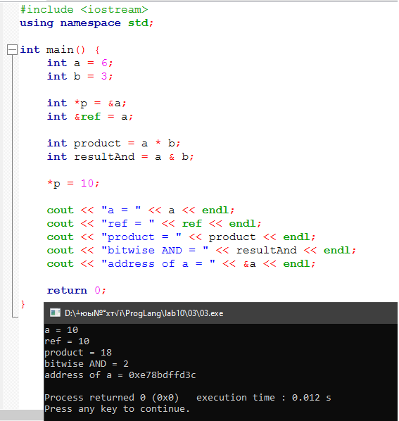
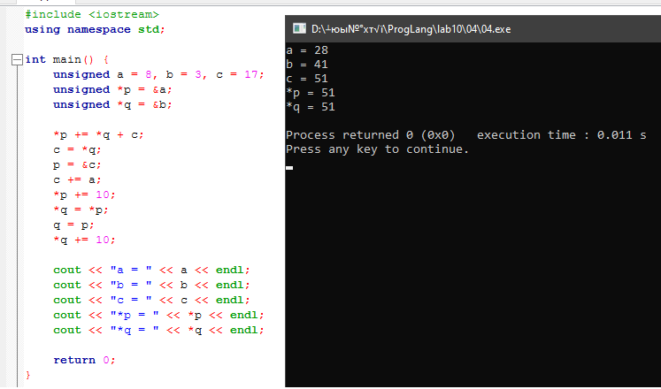
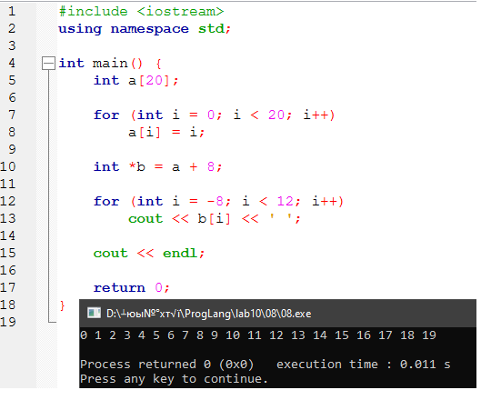
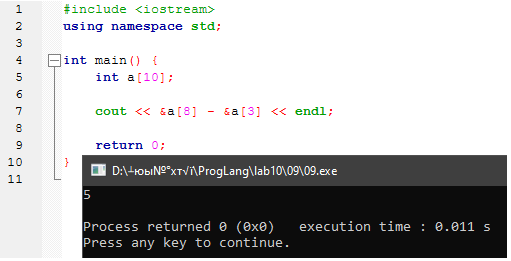
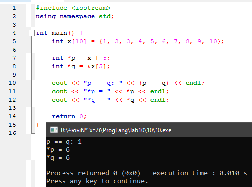

# Языки программирования

## Лабораторная работа 10

### Задание 1 **(2)**

*Рассмотрите следующие фрагменты программ. Запишите, что означают символы* **&** и  * *в каждом случае применения.*

```
int a = 10, b = 20;
int *p = &a , *q = &b;
p = q;
std::cout << *p <<' '<< *q << std::endl;
```

```
int a = 10, b = 20;
int *p = &a , *q = &b;
*p = *q;
std::cout << *p <<' '<< *q << std::endl;
```

*Чем различаются присваивания в третьей строке? Что можно вывести,
чтобы показать различия?*

*Примеры программ сохраните в папке с номером задания. Скриншоты работы прикрепите к отчету.*


звездочка в обьявлении переменной означает описатель указатель. Звездочка в выражении означает оператор разименование и оператор взятия адреса. Сначала берется значение по адресу у p и присваевается к значению адреса q. В первом случае p и q начинают хранить один и тот же адрес, на переменную b, а значения самих переменных при этом не изменяются. Во втором *p =*q; копируется значение, которое находится по адресу q. Поэтому значение a = значению b, но указатели продолжают указывать на разные переменные.


### Задание 2 **(1)**

*Рассмотрим следующую программу.*

```
double x[10];
for (int i = 0; i <10; i++)
    std::cout << &x[i] << std::endl;
```

*Что она выводит? Измените
вывод так, чтобы адреса выводились в десятичной системе счисления.
Объясните почему числа составляют арифметическую прогрессию с
определенным шагом.*

*Записанную программу сохраните в папке с номером задания.*
*Скриншоты работы прикрепите к отчету.*




Программа выводит адреса элементов массива. Для вывода в десятичной системе адрес преобразуется к целому типу. Элементы массива идут подряд в памяти, поэтому адрес каждого следующего элемента больше на размер одного элемента. В данном случае размер double равен 8 байтам, поэтому адреса образуют арифметическую прогрессию с шагом 8. Размер double зависит от реализации.

### Задание 3 **(2)**

*Токен* **«*»** *в языке C++ может использоваться в трех различных
случаях. Аналогично токен* **«&»** *также может использоваться в трех
случаях. Приведите пример одной программы в которой они были бы
использованы во всех случаях.*

*Записанную программу сохраните в папке с номером задания.*



В программе показаны три варианта применения символа * и три варианта применения символа &. Символ * используется при объявлении указателя, при получении значения по адресу и как операция умножения. Символ & используется при объявлении ссылки, при получении адреса переменной и как побитовая операция И.

### Задание 4 **(2)**

*Выпишите значения всех переменных, в том числе указателей,
после выполнения каждой инструкции программы. Объясните, что
происходит в результате выполнения каждой инструкции.*

```
unsigned a = 8, b = 3 ,c = 17;
unsigned *p = &a;
unsigned *q = &b;
*p += *q + c;
c = *q;
p = &c;
c += a;
*p += 10;
*q = *p;
q = p ;
*q += 10;
```



После объявления a равно 8, b равно 3, c равно 17. Указатель p ссылается на a, указатель q на b.

После *p += *q + c значение a равно 28, b равно 3, c равно 17. К a прибавляется сумма b и c. Указатели не меняются.

После c = *q значение c равно 3, a равно 28, b равно 3. В c записывается значение b. Указатели не меняются.

После p = &c указатель p ссылается на c, q на b. Значения a, b и c равны 28, 3 и 3.

После c += a значение c равно 31, a равно 28, b равно 3. Указатели ссылаются на c и b соответственно.

После *p += 10 значение c равно 41, a равно 28, b равно 3. Через p изменяется c. Указатели не меняются.

После *q = *p значение b равно 41, a равно 28, c равно 41. Через q в b записывается значение c.

После q = p оба указателя ссылаются на c. Значения a, b и c равны 28, 41 и 41.

После *q += 10 значение c равно 51, a равно 28, b равно 41. Через q изменяется c. Оба указателя по-прежнему ссылаются на c.

### Задание 5 **(1)**

*Что сравнивается в приведенной ниже программе? Как можно
изменить первую строчку программы, чтобы результат тоже
изменился?*

```
int x = 1, y = 2;
int *p = &y, *q = &x;
if (p < q)
    std::cout << "Yes";
else
    std::cout << "No";
```


В первых двух кодах они локальные, лежат в стеке. Если y объявлена позже x, её адрес меньше, поэтому выводится Yes. Если поменять порядок объявления, адрес y станет больше, и выводится No. В третьем коде переменные static, он меняет расположение переменных в памяти, и результат сравнения указателей может отличаться от локальных. Они хранятся в статической области. Тут адрес y > адреса x, поэтому вывелось Yes. Но все зависит от компилятора.

### Задание 6 **(2)**

*Объясните работу следующей программы. Как изменится
результат, если тип* **double** *изменить на некоторый другой, например*
**int** *или* **char**?

```
double x = 0;
double *d = &x;
std::cout << reinterpret_cast<size_t>(d + 4) - reinterpret_cast<size_t>(d - 4) << std::endl;
```


В программе вычисляется разница между адресами d + 4 и d - 4. Прибавление или вычитание числа к указателю выполняется не в байтах, а в количестве элементов указанного типа. Для типа double разница между этими адресами составляет 8 элементов. Если размер double равен 8 байтам, результат будет равен 64 байтам. Если заменить double на int, результат обычно будет равен 32 байтам при размере int 4 байта. Для char результат будет равен 8 байтам, так как размер char составляет 1 байт.

### Задание 7 **(2)**

*Объясните работу следующей программы. Как изменится
результат, если тип* **double** *изменить на некоторый другой, например*
**int** *или* **char**?

```
std::cout << reinterpret_cast <double*>(3000) - reinterpret_cast <double*>(2000) << std::endl;
```


3000 и 2000 преобразуются в указатели, затем указатели вычитаются. Получилось 125(3000-2000=1000 и 1000/8 = 125), так как разность адресов 1000 делится на размер double, равный 8 байтам. Это соответствует количеству промежутков размером double на указанном расстоянии. При аналогичном вычислении для int размером 4 байта получилось бы 250, а для char получилось бы 1000. Однако такие указатели не указывают на элементы одного массива, поэтому их вычитание имеет неопределенное поведение.

### Задание 8 **(2)**

*Что надо дописать в записанной ниже программе вместо многоточий, чтобы
она выводила все числа из массива* **a**? *Почему?*

```
int a[20];
for ( int i = 0; i < 20; i++)
    a[i] = i;
int *b=a + 8;
for (int i =; i <...; i++)
    std::cout << b[i] <<' ';
```



b[i] ==== *(b+i)
Указатель b установлен на элемент массива с индексом 8. Чтобы вывести весь массив через этот указатель, счетчик начинается со значения -8 и заканчивается значением 11 включительно. b[i] обращается к элементу по смещению i относительно адреса, который хранится в b. Поэтому при значении i, равном -8, выводится первый элемент массива, а при значении 11, последний.

### Задание 9 **(2)**

*Что выводит следующая программа? Изменится ли результат если
изменить тип элементов массива?*

```
int a[10];
std::cout << &a[8] - &a[3] << std::endl;
```


Программа выводит разность адресов восьмого и третьего элементов массива. При вычитании указателей на элементы одного массива результат выражается в количестве элементов. Между элементами с индексами 3 и 8 находится разница в 5 элементов, поэтому вывод 5.

При изменении типа элементов массива результат не изменится, так как разность указателей по-прежнему будет равна пяти элементам.


### Задание 10 **(1)**

*Есть ли разница между инициализацией* **p** и **q** *в следующей программе? Обоснуйте ответ.*

```
int x [10]={1, 2, 3, 4, 5, 6, 7, 8, 9, 10};
int *p = x + 5;
int *q = &x[5];
```



Инициализация указателей p и q выполняется разными способами, но результат получается одинаковым. x + 5 указывает на элемент массива с индексом 5. &x[5] получает адрес этого же элемента. Оба указателя хранят один и тот же адрес и обращаются к одному элементу массива.

### Задание 11 **(3)**

*Указатели можно использовать для итерации по массивам.
Напишите программу, которая найдет сумму элементов массива,
используя указатели. В начале цикла указатель требуется установить
на начало массива, в конце каждой итерации смещать его к
следующему элементу массива через инкремент. Для выхода из цикла
надо проверять, что указатель дошел до конца массива.*

```
int x [10]={1, 2, 3, 4, 5, 6, 7, 8, 9, 10};
int s = 0;
for (int *p = ...; ...; ...)
    s += ...
std::cout << s;
```

*Записанную программу сохраните в папке с номером задания.*

В программе считается сумма элементов массива через указатели. Массив x задан от 1 до 10, переменная s для суммы изначально равна нулю. В цикле for указатель p сначала ставится на начало массива (p = x). Условие p < x+10 проверяет, что мы не вышли за границу массива (тк x+10 это адрес после последнего элемента). В конце каждой итерации p++ сдвигает указатель на следующий элемент (указатель сам знает размер типа, поэтому прыгает сразу на следующий int, а не на 1 байт). Внутри цикла s += *p берет значение по адресу указателя и прибавляет к сумме. В итоге на экран выводится 55.


## Дополнительные задания

### Задание 1 **(3)**

*Запишите программу на С++, в которой будет создаваться двумерный массив* **x[10][10]**. *Выведите адреса элементов массива и нарисуйте, как элементы расположены в памяти.*

### Задание 2 **(3)**

*Запишите программу на С++, в которой будет создаваться двумерный массив* **x[10][10]**. *Проверьте, что произойдет при различных выходах за границы массива. Напишите программы для демонстрации и поясните
их работу.*

### Задание 3 **(6)**

*Напишите пример программы, которая продемонстрирует неопределенное поведение при выходе за границу одномерного массива. Например, чтобы программа зависла, хотя по алгоритму такого не должно произойти

### Задание 4 **(8)**

*Изучите самостоятельно работу с динамической памятью. Напишите примеры программ, демонстрирующие особенности работы (например, перемещение при расширении) и возможные ошибки при работе с памятью.*
