# Языки программирования
## Лабораторная работа 9

### Задание 1 **(2)**
*Рассмотрим следующую программу.*
```
d = {'sep': ',' , 'end': '\n'}
l = ['Утопия', 14, 'Вселенная', 25]
print (l, d)
print (*l, d)
print (*l, *d)
print (*l, **d)
```
*Объясните результаты ее работы.*

*При устном ответе на вопросы вам потребуется рассказать, что такое "Утопия 14" и "Вселенная 25".*

Вывод программы:
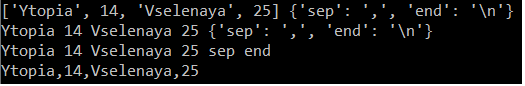

У Функции print есть sep (разделитель) и end (что выводить в конце). "*" при вызове разворачивает последовательность в отдельные аргументы, "**" разворачивают словарь в именованные аргументы. В первой строке print(l, d) получает два аргумента, список и словарь. Они выводятся в том виде, в котором записываются в программе, то есть список в квадратных скобках со строками в кавычках, а словарь в фигурных скобках. Во второй строке *l разворачивает список в четыре отдельных аргумента. Поэтому элементы идут через пробел, строки выводятся без кавычек, а словарь остается одним аргументом и выводится целиком. В третьей строке *d разворачивает словарь, но при такой распаковке берутся только ключи(sep и end). В print уходят две строки sep и end как обычные аргументы, и они печатаются через пробел после элементов списка. В четвертой строке **d разворачивает словарь в именованные аргументы, и вызов превращается в print('Ytopia', 14, 'Vselenaya', 25, sep=',', end='\n'). Теперь sep и end настраивают саму функцию. Элементы разделяются запятой без пробелов, а после последнего элемента выводится перевод строки.

### Задание 2 **(2)**
*Напишите функцию* **sublist** для решения следующей задачи.*

*На вход функции поступает список или кортеж и набор номеров позиций.
Функция должна составить и вернуть список из элементов, которые
находятся на этих позициях. Примеры работы приводятся ниже. Работа функции должна строго им соответствовать.*

```
>>> lst = [ 'Anna', 'Barbara', 'Clara', 'Diana', 'Eva', 'Flora']
>>> sublist(lst, 0, 2, 5)
['Anna', 'Clara', 'Flora']
>>> sublist (lst)
[]
>>> sublist(lst, 0, 1, 2, 3, 4, 5)
['Anna', 'Barbara', 'Clara', 'Diana', 'Eva', 'Flora']
```

Фрагмент программы: функция
```py
def sublist(lst, *num):
    return[lst[i] for i in num]
```

Вывод программы:
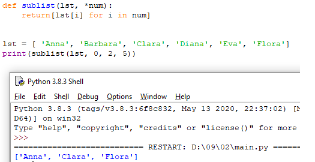

"*" перед num собирает все числа, переданные после lst, в кортеж. Если номера не передали, кортеж получается пустым и функция возвращает пустой список, как во втором примере из условия. Для каждого номера берется элемент lst[i], поэтому функция подходит и для списка, и для кортежа, а результат всегда будет списком.

### Задание 3 **(1)**

*Задан список* **lst** *из натуральных чисел*. *Напишите фрагмент
программы, состоящий из одного вызова функции* **max**, *который найдет в этом списке число с максимальным
числом единиц в двоичной записи.* 

*Многоточие надо заменить на лямбда-функцию, использующую фукцию* **bin** *и метод строк* **count**.

*Пример работы приводится ниже.*
```
>>> lst = list(range(6000 ,7000))
>>> ans = max(lst,...)
>>> print(ans)
6143
```
Программа:
```py
lst = list(range(6000 ,7000))
x = max(lst, key = lambda x: bin(x).count('1'))
print(x)
print(bin(x))
```

Вывод прграммы:
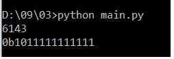

У функции max есть параметр key. С ним числа сравниваются не по значению, а по тому, что вернет эта функция для каждого числа. Лямбда-функция делает bin(x), то есть строку с двоичной записью вида 0b1011, и методом count('1') считает в ней единицы(cимволы b и 0 в приставке единицами не считаются). Программа выводит 6143, а его двоичная запись 0b1011111111111 содержит 12 единиц из 13 разрядов.

### Задание 4 **(2)**

*Запишите фрагмент программы, которая упорядочит список слов
по длине, а при равенстве длины - лексикографически. Сортировка
должна состоять из одного вызова метода* **sort**.

*Пример работы приводится ниже.*

```
>>> lst = ['hello', 'hell', 'bye', 'world', 'bybye']
>>> lst.sort (...)
>>> print (lst)
['bye', 'hell', 'babye', 'hello', 'world']
```

Программа:
```py
lst = ['hello', 'hell', 'bye', 'world', 'bybye']
lst.sort (key = lambda x: (len(x), x))
print (lst)
```

Вывод прграммы:
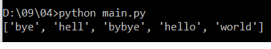

Ключом сортировки служит кортеж из двух элементов, длины слова и самого слова. Кортежи сравниваются по элементам слева направо, поэтому сначала сравниваются длины, а сами слова сравниваются между собой только при равной длине. Строки сравниваются посимвольно. Слова из пяти букв встали по алфавиту, bybye, hello, world. 

### Задание 5 **(2)**

*Напишите программу для решения следующей задачи.*

*В одной строке через запятую записана последовательность слов. Перед
запятой или после нее могут быть пробелы, сами слова пробелов не
содержат. Программа должна вывести в одной строке через запятую
последовательность чисел, равных длине каждого слова. Например,
для ввода*
```
hello   ,   world ,   and ,   goodbye
```
*программа должна вывести*
```
5, 5, 3, 7
```
*Программа должна быть написана с использованием парадигмы функционального программирования, то есть без использования циклов, присваиваний и т.д. Программа может использовать функции* **input**, **print**, **len**, **map** *и методы строк* **split** и **strip**.

Програма:
```py
print(*map(len,
           map(str.strip, 
               input().split(','))),
      sep=', ')
```

Вывод прграммы:
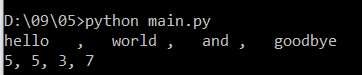

Сначала input().split(',') режет введенную строку по запятым. Получаются части, у которых по краям могут быть пробелы. Затем внутренний map применяет str.strip к каждой части и убирает эти пробелы, а внешний map заменяет каждое слово его длиной. Звездочка перед результатом разворачивает его в отдельные аргументы print, а параметр sep=', ' ставит между числами запятую с пробелом.


### Задание 6 **(2)**

*Запишите генератор в форме функции, который будет создавать
последовательность по следующему правилу.*

* *Если текущее число x в последовательности четное, то следующее число равно x/2.*
* *Иначе следующее число равно 3x + 1.* 

*Последовательность начинается с заданного числа n и заканчивается единицей.*

*Далее приведен пример работы генератора.*
```
>>> print (*gen(7))
7 22 11 34 17 52 26 13 40 20 10 5 16 8 4 2 1
```

Программа:
```py
def gen(x):
    yield x
    while x != 1:
        if x % 2 == 0:
            x //= 2
        else:
            x = 3 * x + 1
        yield x
print(*gen(7))
```

Вывод программы:
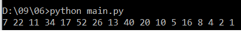

Функция с yield становится генератором. Она выдает числа по одному и запоминает, где остановилась. Сначала выдается стартовое число, потом в цикле считается следующее и тоже выдается. Для четного числа используется целочисленное деление, потому что обычное деление дало бы вещественное число (в примере выводятся целые). Для нечетного берется 3 * x + 1. Цикл идет, пока x != 1, а единица выдается последней, потому что сразу после вычисления попадает в yield.

### Задание 7 **(2)**

*Напишите генератор, который для заданной последовательности*
**seq** *будет задавать последовательность из каждого второго элемента* **seq**.

```
def every_other(seq):
    ...
```
*Ниже приведены примеры использования генератра.*
```
>>> print (*every_other([10, 20, 30, 40, 50]))
10 30 50
>>> print(*every_other(range(10)))
0 2 4 6 8
>>> print(*every_other(iter(range(10))))
0 2 4 6 8
>>> print(sum(every_other(map(int, input().split()))))
2 5 11 3 8
21
```

Программа:
```py
def every_other(seq):
    for i, x in enumerate(seq):
        if i % 2 == 0:
            yield x


print(*every_other([10, 20, 30, 40, 50]))
print(*every_other(range(10)))
print(*every_other(iter(range(10))))
print(sum(every_other(map(int, input().split()))))
```

Вывод программы:
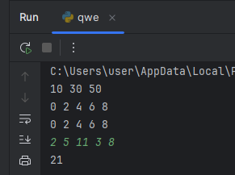

Цикл for подходит и для списка, и для range, и для итератора. Функция enumerate нумерует элементы с нуля, и выдаются элементы с четными номерами, то есть первый, третий, пятый и так далее. Генератор выдает значения по мере запроса, поэтому sum считает сумму прямо по ходу. Для списка из условия получается 10 30 50, для range(10) и для iter(range(10)) получается 0 2 4 6 8, а для ввода 2 5 11 3 8 сумма равна 2 + 11 + 8 = 21. Для пустой последовательности ничего не выдается.


### Задание 8 **(2)**

*Задан список* **lst**, *в котором записаны вперемешку числа и строки.*. 
*Напишите фрагмент программы, состоящий из одного конструктора списков, который построит новый список, состоящий только из чисел.* 

*Определить тип объекта в Python можно с использованием функции* **type**.

*Пример работы приводится ниже.*

```
>>> lst = [1,'abc', 2, 3, 4, 'aa']
>>> nums = [...]
>>> print(nums)
[1, 2, 3, 4]
```

Программа:
```py
lst = [1, 'abc', 2, 3, 4, 'aa']
nums = [x for x in lst if type(x) in (int, float)]
print(nums)
```

Вывод программы:
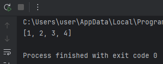

Конструктор списка перебирает элементы lst и оставляет только те, у которых тип int или float, то есть числа. Строки отсеиваются условием, потому что у них тип str. Результат получается [1, 2, 3, 4]. Проверка сделана через type. Значения True и False в результат не попадут, так как их тип bool, а не int.

###  Задание 9 **(2)**

*Напишите фрагмент программы, состоящий из одного конструктора списков, который построит двумерный список в виде таблицы умножения размера* 
**n×n**.

*Пример работы приводится ниже.*

```
>>> n = 5
>>> tblmul = [...]
>>> print(*tblmul,sep='\n')
[1, 2, 3, 4, 5]
[2, 4, 6, 8, 10]
[3, 6, 9, 12, 15]
[4, 8, 12, 16, 20]
[5, 10, 15, 20, 25]
```

Программа:
```py
n = 5
tblmul = [[i * j for j in range(1, n + 1)] for i in range(1, n + 1)]
print(*tblmul, sep='\n')
```

Вывод программы:
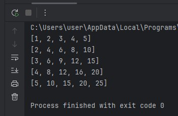

Здесь два вложенных конструктора списков. Внутренний строит одну строку таблицы, то есть произведения числа i на числа от 1 до n. Внешний перебирает i от 1 до n и собирает эти строки в один двумерный список. Вывод через print(*tblmul, sep='\n') печатает каждую строку на отдельной строчке, и получается таблица из условия, от [1, 2, 3, 4, 5] до [5, 10, 15, 20, 25]. Диапазоны начинаются с 1, потому что при range(n) в таблице появились бы нули и она бы сдвинулась.

###  Задание 10 **(1)**
*Какие из указанных функций и методов Python соответствуют определению чистых функций?
В случае отрицательного ответа требуется дать пояснение.*

* **file.readline|** — *чтение строки из файла.*
* **len** — *определение длины строки или количества элементов в контейнере.*
* **list.append** — *добавление в список нового элемента.*
* **sum** — *нахождение суммы.*
* **sorted** — *построение сортированного списка.*
* **list.sort** — *сортировка списка.*
* **random.randint** — *генерация случайного целого числа.*
* *Разворот списка.*
```
def rev(x):
    return x[::-1]
```
* *Выбор нескольких элементов из хвоста списка.*
```
tail_len = 3
def tail(x):
    return x[-tail_len:]
```

Программа:
```py
import random

lst = [3, 1, 2]
print(sorted(lst), lst)
print(lst.sort(), lst)
print(lst.append(7), lst)
print(random.randint(1, 100), random.randint(1, 100))


def rev(x):
    return x[::-1]


tl = 3


def tail(x):
    return x[-tl:]


a = [1, 2, 3, 4, 5]
print(rev(a), a)
print(tail(a))
tl = 2
print(tail(a))
```

Вывод программы:
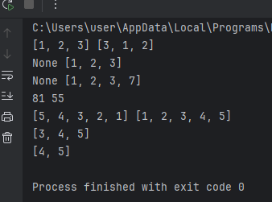

Чистая функция, это когда при одинаковых аргументах всегда получается одно и то же, она не имеет побочных эффектов(не меняет свои аргументы глобальные переменные, файлы и тд).

Метод file.readline не чистый, при каждом вызове он возвращает следующую строку, потому что результат зависит от текущей позиции в файле, а позиция сдвигается после каждого чтения. Функция len чистая, результат зависит только от переданного контейнера и ничего не меняется. Метод list.append не чистый, он изменяет сам список и возвращает None. Функция sum чистая, она только считает сумму элементов и не меняет их. Функция sorted чистая, потому что строит новый отсортированный список, а исходный остается прежним. Метод list.sort не чистый, он сортирует список на месте, то есть меняет аргумент, и возвращает None. Функция random.randint не чистая, при одинаковых аргументах результаты разные, так как она зависит от внутреннего состояния генератора случайных чисел, которое меняется после каждого вызова. Функция rev чистая, срез с шагом минус один создает новый список, исходный x не меняется, а результат зависит только от x. Функция tail не чистая, кроме аргумента x она использует глобальную переменную tail_len, если изменить tail_len, тот же вызов с тем же x вернет другой результат, то есть результат зависит не только от аргументов.

###  Задание 11 **(2)**
*Рассмотрите следующую функцию.*
```
def toint(fun):
    def wrapper(*args):
        return fun(*map(int, args))
    return wrapper
```
*Что передается в функцию* **toint**? *Что возвращает эта функция?*
*Что делает функция* **wrapper**?
*Придумайте несколько примеров использования* **toint**.

Программа:
```py
def toint(fun):
    def wrapper(*args):
        return fun(*map(int, args))
    return wrapper


add = toint(lambda a, b: a + b)
print(add('2', '3'))
print(max('10', '9', '100'))
print(toint(max)('10', '9', '100'))


@toint
def mul(a, b):
    return a * b


print(mul('6', '7'))
print(toint(pow)('2', '10'))
print(toint(divmod)('17', '5'))
```

Вывод программы:
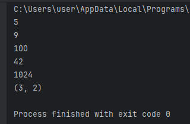

В функцию toint передается другая функция fun, которая работает с числами. Сама toint возвращает функцию wrapper. Эта вложенная функция запоминает fun из внешней функции, поэтому wrapper можно вызывать позже. Функция wrapper принимает любое число позиционных аргументов, переводит каждый из них в целое число через map(int, args), вызывает fun с этими числами и возвращает результат. Получается, что toint создает версию функции, которой можно передавать числа в виде строк, например прочитанные через input().split().

Функция add, созданная через toint, для строк '2' и '3' возвращает 5, тогда как обычное сложение этих строк дало бы '23'. Обычный max для строк '10', '9' и '100' вернет '9', потому что строки сравниваются по символам, а toint(max) переведет их в числа и вернет 100. Запись @toint над определением mul делает то же самое, что mul = toint(mul), и mul('6', '7') возвращает 42. Еще toint применен к pow и к divmod, получились 1024 и (3, 2). У wrapper есть ограничение, он принимает только позиционные аргументы, а именованные не пропускает.

## Дополнительные задания

### Задание 1 **(3)**

*Самостоятельно познакомьтесь с понятием декораторов в Python. Приведите примеры использования
функции* **toint** *из задания выше в качестве декоратора.*


### Задание 2 **(3)**
*Напишите фрагмент программы, которая найдет в списке слов слово с максимальной длиной. При равенстве длин
найдет самое первое в лексикографическом порядке.*

*Фрагмент программы должен состоять из одного вызова функции* **min** *или* **max**.

### Задание 3 **(5)**

*Напишите рекурсивную функцию для нахождения* **n**-о *числа Фибоначчи.*

*Функция обязательно должна работать с достаточно большими числами, например* **n = 1000** *и не 
должна использовать библиотечные функции и методы.*

### Задание 4 **(9)**

*Напишите функцию* **fastpow**, *которая будет создавать лямбда-функцию для быстрого 
возведения в фиксированную степень* **n**. *Например, должен работать следующий код*
```
>>> pow10 = fastpow(10)
>>> print(pow10(2))
1024
```
*Функция* **fastpow** *в этом примере должна строить выражение для быстрого возведения в степень
по стандартному алгоритму* 
* **x^1 = x**;
* **x^{2n} = (x^n) ** 2**; 
* **x^{2n+1}=x*x^{2n}**;

*Например,
для* **n = 10** *может быть получена подобная строка* ```(x*((x**2)**2))**2```. 

*Далее* **fastpow** *будет возвращать лямбда функцию*
```
lambda x: eval(s)
```
*При написании функции* **fastpow** *можно использовать вспомогательные функции.*


